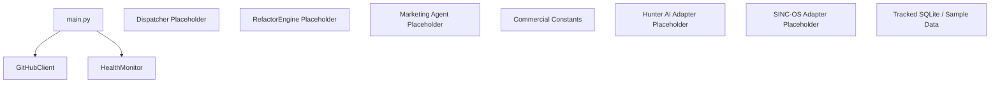

# Zubair Hunter AI — CLT Sovereign OS Concept Scaffold

[](https://www.python.org/)
[](#proof-of-concept--enterprise-customization-readiness)
[](#intellectual-property--authorship)

**This repository is currently a concept scaffold, not an operational autonomous AI-agent platform.** The tracked Python files contain placeholder print statements, fixed return values, and configuration constants. No working 60-agent system, encryption layer, payment processor, or subscription flow was verified in the current source tree.

The project name and current README branding refer to a CLT Sovereign OS concept. This document describes only what is present in the repository and explicitly records the gaps.

## 1. Project Overview & Problem Statement

The concept describes a coordinated digital-agent environment for marketing, commercial operations, and ecosystem management. The current repository does not yet implement that system.

The source currently contains:

- A minimal `clt_maestro.py` entry point that prints an activation message.
- A `marketing_agent.py` placeholder that prints a readiness message.
- A `commercial_logic.py` file with a price constant and a list of proposed payment methods.
- A basic GitHub REST client using the third-party `requests` package.
- Placeholder dispatcher, health-monitor, refactor-engine, and adapter classes.
- A Docker Compose file referencing a root Dockerfile that is not present in the reviewed tree.
- Sample datasets and several tracked SQLite database/configuration artifacts.

### Current architecture



These modules are not connected into a running multi-agent orchestration graph. The diagram represents the files present, not a verified operational system.

## 2. Tech Stack & Versions

| Area | Current evidence |
|---|---|
| Language | Python |
| GitHub integration | GitHub REST API wrapper using `requests` |
| Container orchestration | Docker Compose file present, but root Dockerfile missing |
| Data artifacts | SQLite database files and sample CSV/JSON datasets |
| AI runtime | No model runtime, model files, inference API, or agent framework verified |
| Automation | No current `.github/workflows/` files present in the reviewed main tree |
| Testing | No test suite or test configuration found |

No root `requirements.txt`, `pyproject.toml`, lockfile, or declared supported Python version is present. The GitHub client imports `requests`, but that dependency is not declared in a project manifest.

## 3. Prerequisites & Dependencies

For limited inspection of the Python scaffold:

- Python 3.
- The `requests` package for `core/github_client/client.py`.
- Git for repository operations.

For Docker Compose, a root Dockerfile must first exist; the current Compose file references `build: .` but the reviewed tree contains no root Dockerfile.

The SQLite files are repository artifacts, not a configured production database service. No database server or AI model is provisioned by the current project.

## 4. Installation & Local Setup

Clone the repository:

```bash
git clone https://github.com/zopair/Zubair-Hunter-AI.git
cd Zubair-Hunter-AI
```

Install the currently visible GitHub-client dependency for local inspection:

```bash
python -m venv .venv
source .venv/bin/activate
python -m pip install requests
```

Run the minimal entry point:

```bash
python main.py
```

This only initializes the simple GitHub client and placeholder health monitor, then prints status messages. It does not crawl repositories, execute agents, analyze security, or refactor code.

The `clt_maestro.py` and `marketing_agent.py` files are also print-only placeholders:

```bash
python clt_maestro.py
python marketing_agent.py
```

### Docker Compose

The current `docker-compose.yml` references a root Dockerfile that is absent from the repository tree. A Compose build is therefore not a supported setup path at this time.

## 5. Environment Variables

| Variable | Used by | Purpose |
|---|---|---|
| `GITHUB_TOKEN` | `core/github_client/client.py` | GitHub REST authorization for the basic repository client |

The client currently constructs an Authorization header from `GITHUB_TOKEN`. It does not implement token validation, rate-limit handling, pagination, retries, or a least-privilege scope contract.

No payment credentials, AI provider keys, model configuration, encryption keys, or database connection settings are defined by the current code.

Never commit GitHub tokens, cloud credentials, customer data, or database snapshots containing private records.

## 6. Usage Guide & Core Features

### A. GitHub client

`core/github_client/client.py` contains a basic `get_repos(user)` wrapper around the GitHub public user-repositories endpoint. It returns the decoded JSON response and does not currently implement robust error handling, pagination, or retry/backoff behavior.

### B. Orchestration placeholders

- `main.py` instantiates the GitHub client and health monitor, then prints a monitoring message.
- `orchestration/dispatcher.py` prints a task assignment; it does not dispatch work.
- `orchestration/health_monitor.py` returns a fixed score of 100 and status `Healthy`; it does not inspect repository data.
- `automation/refactor_engine.py` returns an empty action list and `optimized: true`; it does not analyze or modify code.
- `services/hunter_ai_adapter.py` and `services/sinc_os_adapter.py` are empty adapter classes.

### C. Marketing and commercial placeholders

- `marketing_agent.py` prints a readiness message; it does not publish or manage campaigns.
- `commercial_logic.py` declares a current price constant of 75 and a list of payment-method names. It does not process payments, verify transfers, issue memberships, or manage subscriptions.
- The previous claim of a $75 lifetime membership is not backed by an implemented checkout or entitlement system.

### D. Data and local configuration artifacts

The repository currently tracks several SQLite files, including `CLT_Sovereign_Empire.db`, `Client_001_sovereign.db`, and `agents_status.db`, plus a `.config/` directory containing local cloud CLI configuration/log artifacts.

Their contents have not been validated as safe for public redistribution as part of this README-only review. Treat them as potentially sensitive until their provenance, data classification, and contents are audited. Do not copy or publish database rows, account identifiers, cloud configuration, or logs without confirming they contain no private information or credentials.

A limited pattern check of selected text configuration files did not detect common token formats; this was not a comprehensive secret scan and does not establish that the tracked artifacts are safe.

### E. Sample data

`sample_data/` contains common demonstration datasets such as California housing, MNIST sample data, and Anscombe's quartet. See [sample data notes](sample_data/README.md) for source references.

## 7. Live Demo & Screenshots

No hosted application, live agent dashboard, or operational API endpoint is configured in the current repository tree.

The only reproducible demonstration is running the placeholder Python entry points locally. No public demo or screenshot is claimed as proof of an autonomous agent system.

Historical GitHub Actions runs exist in repository history, but no current workflow files were present in the reviewed main tree; the historical runs do not establish that an automation workflow remains reproducible from the current source.

## 8. Testing & Verification

No dedicated automated test suite was found in the reviewed repository tree. No root dependency manifest, pytest/unittest suite, Docker build workflow, or CI workflow is currently present.

Before calling the repository operational, it needs:

- Unit tests for the GitHub client, dispatcher, health monitor, and commercial rules.
- Contract tests for every agent adapter.
- A real task-execution path with explicit tool permissions and failure handling.
- A reproducible dependency manifest and supported Python version.
- A valid Dockerfile or removal/rework of the incomplete Compose build definition.
- A data-provenance and privacy review for the tracked SQLite/configuration artifacts.
- A secret scan across the complete repository history and current tracked files.

## Proof of Concept & Enterprise Customization Readiness

<badge color="danger">Concept scaffold — not production-ready</badge>

| Capability | Current state |
|---|---|
| Multi-agent runtime | Not implemented |
| 60 specialized agents | Not present in current source tree |
| Encryption / AES-256 | No encryption implementation verified |
| GitHub API access | Basic `requests` wrapper only |
| Repository health analysis | Placeholder fixed score; no real analysis |
| Autonomous task dispatch | Placeholder print statement |
| Automated refactoring | Placeholder returns no actions |
| Marketing automation | Placeholder print statement |
| Commercial pricing | Constant only; no commercial transaction |
| Payment processing | Not implemented |
| Membership / entitlements | Not implemented |
| Persistent database service | Tracked SQLite artifacts only; no configured service or schema contract verified |
| Docker deployment | Compose references a missing root Dockerfile |
| CI / automated tests | No current workflow or test suite found |
| Data provenance / public hygiene | Tracked local cloud configuration and SQLite files require review |
| Project license | No root `LICENSE` file present |

### Readiness gates

1. Resolve the conflicting project identity metadata before asserting exclusive authorship or commercial ownership.
2. Audit and remove/redact sensitive local configuration and database artifacts; rotate any credential if a secret is discovered.
3. Define the actual product scope and architecture before implementing the agent runtime.
4. Add real, testable GitHub operations with pagination, bounded retries, and rate-limit handling.
5. Implement agent/task contracts, tool permissions, state persistence, and observability.
6. Implement any encryption and payment features before describing them as available.
7. Add dependency, test, and deployment workflows.
8. Select a project license and verify third-party dataset/library obligations.

## Intellectual Property & Authorship

Requested project attribution: **Aly Hussein Zopair (علي حسين زبير ALY HUSSEIN ZOPAIR)**.

**Provenance conflict requiring resolution:** the tracked `IDENTITY.txt` currently names `Prince Sultan` and `Al-Zubair Tec Investment` as owner/company. This conflicts with the requested project attribution. The README therefore does not claim exclusive legal ownership or registration; resolve the identity record and review contribution history before commercial or legal use.

This notice does not create a software license or override third-party dataset, cloud-tool, or dependency rights.
